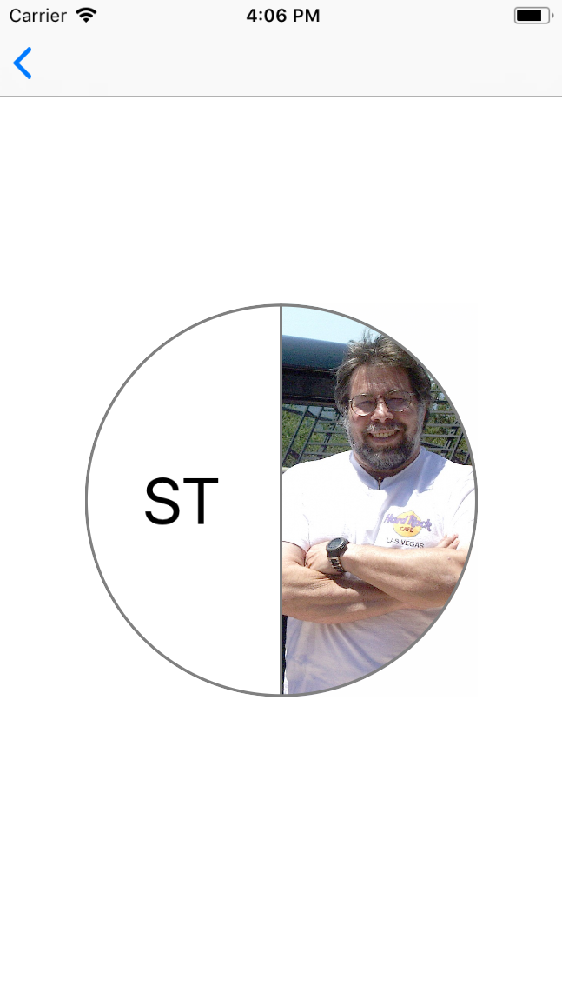
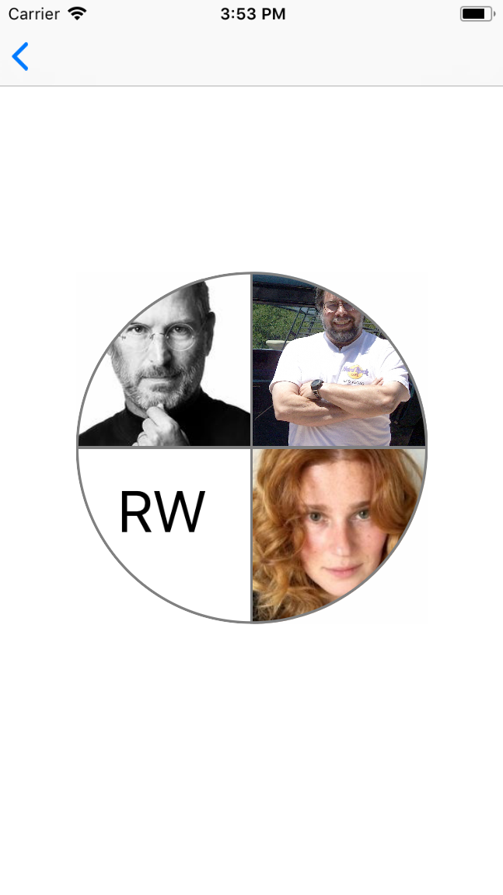

# JNGroupAvatarImageView

[](http://cocoapods.org/pods/JNGroupAvatarImageView)
[](http://cocoapods.org/pods/JNGroupAvatarImageView)
[](http://cocoapods.org/pods/JNGroupAvatarImageView)

**JNGroupAvatarImageView** is used to show group or single avatar image with the option to show initials, it can show 4 images at most.

## Screenshots






## Requirements

- iOS 12.0+ / macOS 15.7+
- Xcode 26+
- Swift 5.10+

## Installation with Swift Package Manager

JNGroupAvatarImageView support SwiftPM. To use SwiftPM, you should use Xcode 26 to open your project. Click `File` -> `Swift Packages` -> `Add Package Dependency`, enter [JNGroupAvatarImageView repo's URL](https://github.com/JNDisrupter/JNGroupAvatarImageView.git)

## Usage

#### To add JNGroupAvatarImageView in interface builder:

1. Put some UIView and change the class to "JNGroupAvatarImageView"

2. Add refrence for it in the view controller.

3. Implement JNGroupAvatar In you class like the following:

```swift
 class User : JNGroupAvatar {

     /**
       Get display name which will be used for the initials.
     - Returns: The display name for the avatar
     */
    func getGroupAvatarDisplayName() -> String {
       return ""
    }
    
    /**
       Get Avatar image url which will be used as avatar url
     - Returns: The image url
     */
    func getGroupAvatarImageUrl() -> String {
        return ""
    }
    
     /**
       Get Avatar image which will be used as avatar
     - Returns: The image 
     */
    func getGroupAvatarImage() -> UIImage {
        return UIImage()
    }
 }
 ```

4. Call setup method with the following parameters:
 
```swift
 func setup(avatars : [JNGroupAvatar] , imagesLayoutDirection : ImagesLayoutDirection , avatarsMargin : CGFloat , separatorColor : UIColor, placeHolderImage : UIImage! , showInitails : Bool , initialsFont : UIFont , initialTextColor : UIColor)
 ```
 
  * avatars : Array fo JNGroupAvatar which will be used to draw .
  * imagesLayoutDirection : The image layout direction to use (right to left or left to right).
  * avatarsMargin : The margin between avatars (separator with or height).
  * separatorColor : The separator color to use.
  * placeHolderImage : The placeholder to use if the image failed to load.
  * showInitails : Show initials if the image failed to load or not, if false then set placeholder image.
  * initialsFont : The font to use for the initials.
  * initialTextColor : The text color to use for the initials.

> The libarary will automaticly adjust initials label insets if the view is circle.

## Authors

Jayel Zaghmoutt & Mohammad Nabulsi

## License

JNGroupAvatarImageView is available under the MIT license. See the [LICENSE](https://github.com/JNDisrupter/JNGroupAvatarImageView/blob/master/LICENSE) file for more info.
